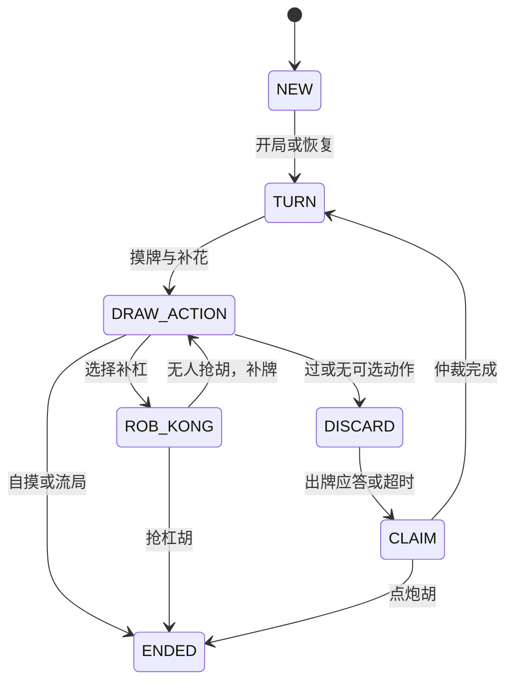

# 房间事件驱动状态机改造（2026-10-24）

本次为本地源码改造，已完成干净构建及回归验证，尚未部署或执行线上容量压测。历史文档中的每房间引擎线程、每房间计时器线程属于改造前实现。

## 备份与恢复

改动前的源码保存在仓库根目录 `backups/event-state-machine-before-20261024-192425/source.zip`，包含后端源码、测试、资源、前端源码及锁文件、pom、运维脚本和阅读文档。备份包含原有两处未提交修改：实际动作优先级仲裁，以及真人控制器的注释调整。

同目录保存 `working-tree.patch`、`base-commit.txt`、`SHA256SUMS.txt`。压缩包已逐项验证 CRC，备份及临时基准工程被 Git 忽略。真实 `.env`、数据库和 Git 对象库不在源码压缩包中。

源码包 SHA-256：`2a17cfd8eb848badecdb77b8c5bfafc233bea107e5e766d03dd3f3562959ba6b`。

需要恢复源码时，先核对校验值，将压缩包解压到独立目录，在其中构建原版本；确认后再替换工作副本。此备份不包含数据库回滚，也不承诺运行中牌局在版本切换时无损恢复。

## 执行模型

- `RoomEventLoop` 是每房间的串行邮箱，工作线程由全进程共用，数量为 `max(2, min(8, availableProcessors))`。每个就绪事件占用一次工作线程，处理后交还，等待输入时不占用线程。
- 单个 `mahjong-deadlines` 调度线程处理全进程超时；超时只提交事件，不在定时器线程上读写手牌或生成快照。取消任务立即从延时队列移除。共享线程为守护线程，生命周期与 JVM 相同。
- `RoomManager.startAsync()` / `resumeAsync()` 返回完成 Future。联机路径使用这两个入口。`start()` / `resume()` 和 `PromptSupport.prompt()` 仅为现有独立调用方保留同步适配器。
- 同一房间的 `RoomManager` 与联机 `MatchRun` 共用邮箱。状态、规则执行、监听器和定期重同步在邮箱内顺序推进；请求发送后立即返回。
- 已有全局推送兜底线程 `mahjong-push-flush` 继续负责发送捕获好的消息，不访问正在变动的手牌。等待期间每秒投递一次空闲事件，以保留重同步及周期快照行为。

## 状态转换

任意活动状态都可进入 `CANCELLED` 或 `FAILED`。取消立即置位并取消决策超时，终止事件清理控制器待决请求；不执行强制出牌，不发送正常结束事件。异常通过 Future 交给联机层，联机层解散房间。

`PromptSupport` 为每次请求设置一次性完成标记。玩家回复、超时、取消竞争同一个标记，只有首次完成能投递后续事件。应答合法性继续由引擎校验；超时或取消后清理真人请求，避免重连重发旧请求。切换托管时记录本次请求的原控制器，清理不受代理切换影响。

吃碰杠胡继续按候选最高优先级决定询问顺序，按玩家实际选择的动作和座位顺序决定最终归属，收集阶段不修改手牌与牌河。抢杠拆成异步询问阶段，确定无人抢胡后才执行补杠和补牌。

联机层由入座事件或宽限期到期启动牌局；一把完成后结算、提交数据库、广播金币，再注册下一把的延迟事件。已移除等待入座轮询、阻塞跑把循环及局间 `Thread.sleep`。房间关闭先取消活动引擎与生命周期计时任务并递增 `engineEpoch`，旧回调不能推进已经关闭的房间或后续轮次。`engineRunning` 防止重复启动，正常一轮结束后进入 `BETWEEN`，继续沿用同一 session 和金币再开一轮。

调试接口使用 `engineMode=EVENT_DRIVEN`、`engineRunning`、`awaitingBind`、`enginePhase`、`pendingTimers`。`pendingTimers` 只统计当前牌局的决策超时（0 或 1），不包括空闲、入座及局间任务。

## 验证

Java 17 / Maven 3.9.16 执行 `mvn clean package`：**106 项测试，105 通过，0 失败，0 错误，1 项 Redis 实库测试按环境跳过**。监控端口测试需要本机回环连接，已在允许本机端口的执行环境中通过。

- 从本次源码备份编译独立旧引擎，生成 400 把固定种子的事件摘要；新旧引擎的摸牌、出牌、副露、报听、回合提示、胡牌和结果字段摘要全部一致。基准文件为 `src/test/resources/engine-traces-before-event-driven.txt`，测试为 `EngineBehaviorParityTest`。
- 原有 400 把机器人回归：379 把胡牌、21 把流局、4 把抢杠，零异常。
- `EventDrivenEngineTest`：200 个等待房间仍只使用最多 8 个共享工作线程、1 个共享超时线程；重复及迟到应答、取消不出牌、超时清理真人请求、100 次回复与强制完成竞争、监听器异常、RESPOND 恢复后的实际动作优先级、TURN 恢复后抢杠。
- `EventDrivenMatchTest`：最后入座立即开局且只创建一次场次、等待入座时关闭、结算后注册停顿且不占工作线程、停顿可取消、打完一轮进入 BETWEEN 并复用场次再开、数据库结算失败关闭房间。
- 原有人机交互、死锁、快照、生命周期、Outbox、战绩及监控测试均随完整构建运行。打包结果已核对包含新增状态机与嵌套类。

## 实施边界

本次减少的是等待时的线程占用。MySQL / Redis / WebSocket 调用沿用现有同步实现，执行 I/O 时仍会占用共享工作线程；不能据此直接提高生产人数上限。需在维护窗口部署后，按现有预热与 CPU / 内存护栏做同档位对照压测，再判断容量收益。

Redis 快照继续沿用 TURN / RESPOND 检查点格式，没有新增进程中待决回调的持久化协议；重启恢复能力仍以既有检查点语义为准。
