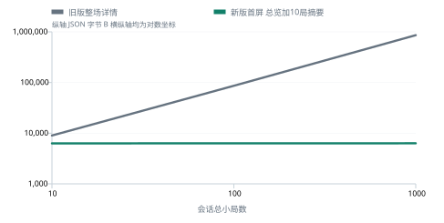
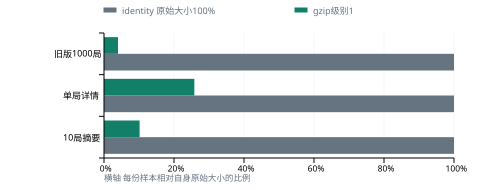

# 海南麻将两日优化前后对比

范围：2026年10月10日至11日，北京时间。来源为实际日志、构造样本测试和只读线上现状；没有优化后公网容量复测。

## 结论

1000局旧整场业务对象为 860,326 B，新首屏总览加10局摘要为 6,319 B，少 99.27%。
独立 Nginx 合成样本10局摘要从5,751 B压至585 B，少89.83%；与MySQL样本不同，不能将两组节省率直接相乘。
线上在 2026-10-11T15:22:21+08:00 复核：战绩路由已返回gzip，监控可读，JAR SHA256与今天产物一致。未登录业务不能作为私有战绩验收。

## 两日改动

- 10月10日 3.1：关闭终态、房间代际/版本和Redis原子保护，迟到任务不能复活关闭快照；30轮并发场景位于真实Redis测试。
- 10月10日 3.2：建立HTTP、WS、JVM、数据库、Redis和主机容量监控；提升的是可观测性，没有已测得的容量增幅。
- 10月11日 4.1：按截止点分页读取战绩，默认每页10局，单局按需读取；冷统计仍可能扫描历史。
- 10月11日 4.2：合并请求、有界缓存、提交后增量刷新、隐藏暂停、关闭清理和最多4次退避。
- 10月11日 4.3：战绩JSON压缩、Vary/private/no-store、配置检查/备份/平滑重载/回退及双编码压测客户端。

## 战绩首屏实测

本机临时MySQL 8.4，四名固定玩家，10/100/1000局构造数据；真实Mapper及新旧业务对象UTF-8序列化，不含Result外壳、HTTP/TLS/gzip。新版首屏计总览加第一页。

| 总局数 | 旧整场 B | 列表 B | 总览 B | 第一页 B | 新首屏 B | 减少 |
| ---: | ---: | ---: | ---: | ---: | ---: | ---: |
| 10 | 9,004 | 269 | 707 | 5,589 | 6,296 | 30.08% |
| 100 | 86,320 | 270 | 717 | 5,590 | 6,307 | 92.69% |
| 1000 | 860,326 | 271 | 727 | 5,592 | 6,319 | 99.27% |

图采用对数坐标。新版首屏需要两次请求，不含后续详情与翻页；读完全部历史不是只传6KB。字节数不能证明延迟、CPU或容量相同比例改善。

## gzip实测

服务器Nginx 1.18.0独立实例，loopback监听，Python合成上游；各级200请求，并发4。正文逐字节解压一致，校验gzip;q=0、Via/Authorization、Vary、最小长度及登录路径不进入战绩压缩范围。

| 样本 | 原始 B | gzip级别1 B | 减少 |
| --- | ---: | ---: | ---: |
| 10局摘要 | 5,751 | 585 | 89.83% |
| 单局详情 | 1,418 | 366 | 74.19% |
| 旧版1000局 | 570,195 | 22,820 | 96.00% |

| 级别 | 摘要 B | 200份正文 B | P95 ms | worker CPU s | lo实际发送增量 B | eth0增量 B |
| --- | ---: | ---: | ---: | ---: | ---: | ---: |
| 0 | 5751 | 1,150,200 | 5.478 | 0.040 | 2,674,104 | 54 |
| 1 | 585 | 117,000 | 4.756 | 0.040 | 1,653,000 | 5,270 |
| 2 | 580 | 116,000 | 4.687 | 0.050 | 1,652,000 | 0 |
| 3 | 577 | 115,400 | 5.499 | 0.050 | 1,651,400 | 1,064 |

级别2/3仅比级别1再少5/8 B，先选1。CPU分辨率是Linux tick；P95包含Python上游，不能用来证明生产延迟收益。lo包括Nginx到上游的另一跳，eth0含其他流量，均不能当成公网战绩节省率。
1KB阈值按Content-Length判断；41 B分块正文也被压缩。WebSocket不包含在HTTP gzip收益中。

## 前端行为验证

| 场景 | 优化后实测 |
| --- | --- |
| 并发总览 | 同时调用2次，HTTP1次 |
| 详情展开收起再展开 | 详情HTTP1次 |
| 两次相同提交通知 | 增量加同截止点总览共2次 |
| 隐藏期间累计17局 | 隐藏时0次请求，恢复时2次；当前页最多10局 |
| 临时失败 | 初次加最多4次重试，总5次；间隔0.5/1/2/4秒 |
| 关闭与返回 | 后续任务停止，旧响应不能覆盖新页面 |

环境为真实Vue挂载、Pinia事件及模拟fetch；旧弹窗openModal/watch两路load来自代码比较，不是生产流量抽样。没有证实旧前端有固定高频轮询，不计算“关闭轮询”收益。后端缓存512场/60秒、前端128条/30秒为设计上限，没有真实命中率数据。

生命周期修复不等于任意重启无损：数据库已提交而快照落后时拒绝恢复；持久关闭与数据库结束写入同时失败后重启仍需核对日志。

## 回归和数据核对

| 批次 | 总数 | 失败/错误/跳过 |
| --- | ---: | --- |
| 10月10日15:22构建 | 69 | 0/0/0 |
| 10月11日14:14 V2完整构建 | 82 | 0/0/0 |
| 10月11日14:41常规回归 | 79 | 0/0/0 |

82=79常规+3实库；79批次没有重复MySQL，不代表回归失败。监控说明70与保留日志69不一致，本报告用日志69。早期SQL日志旧响应少60 B，统一取最终完整日志9004/86320/860326 B。3.1说明记录64项，没有单独原始运行日志用于本报告图表。

## 线上现状与容量边界

采集时间 2026-10-11T15:22:21+08:00。gzip/Vary/private/no-store实际响应头已观察到；私有战绩未登录验收。线上JAR与本地SHA256一致：`069ba5e5e017541a86ffa09f615cc4678d386f671a5b864b14a68ed7c44fce82`。
主机CPU采样 8.06%，进程CPU采样 1.04%，可用内存 470.91 MiB / 总量 1608.90 MiB，JVM线程 43，活跃真人 0，进行中房间 0。这是空闲单点，不是容量对照。
10月8日旧公网战绩列表：目标5 RPS，150响应/0失败/P95约1345ms；目标10 RPS，300响应/1失败/P95约1582ms，未达标准。它早于两日实施窗口，且没有同条件优化后复测。
不能得出在线玩家上限、牌桌倍数、生产P95或公网流量的改善比例。下一轮用相同账号/历史规模/负载/网络路径，采集客户端延迟、成功率、CPU/GC、SQL、实际网卡速率和四人ACK。

## 来源

- [S1] HainanMaJhong/capacity-build.log：10月10日69项常规构建汇总
- [S2] HainanMaJhong/records-v2-package.log：V2 SQL三组字节与82项回归
- [S3] HainanMaJhong/records-4.2-regression.log：79项回归及Redis测试通过
- [S4] docs/performance/results-2026-10-11-gzip/gzip-results.json：4级压缩、字节、CPU、延迟、NIC
- [S5] frontend/tools/check-record-refresh.mjs；frontend-refresh-check.txt：前者在HainanMaJhong下；后者在报告证据目录
- [S6] online-status.txt：线上监控值及nginx -T摘要
- [S7] online-config-check.txt：实际响应头和服务器时间
- [S8] online-jar-sha256.txt：线上JAR SHA256，与本地校验一致
- [S9] HainanMaJhong/src/test/java/hainanMahjong/service/RoomLifecycleRedisTest.java：保存/关闭并发30轮测试源码
- [S10] docs/performance/results-2026-10-08/压测报告.md：旧公网背景，不是两日容量复测

未写完整路径的证据txt位于 `docs/performance/results-2026-10-11-summary`。结构化数据及源文件哈希在 `comparison-data.json`；原始CSV可用于复测。

PDF由 `docs/performance/build-optimization-comparison.py` 生成，分享版不嵌入账号、令牌或真实战绩。
