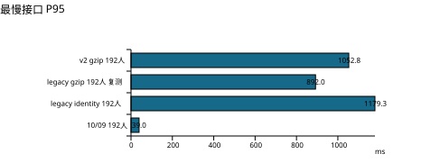

# 海南麻将线上复测对比报告

测试日期：2026-10-11；基线日期：2026-10-09。服务器：39.107.247.119。

本次已测且通过完整验收的最高档位：192 人。

| 档位 | 发压秒数 | HTTP 总数/失败 | 最慢接口 P95 ms | 最慢桌广播 P95 ms | 尾窗 P95 ms | CPU 均值 % | 出网 Mbps | 最低可用 MiB | 验收 |
|---|---:|---:|---:|---:|---:|---:|---:|---:|---|
| 10/09 192人 | 300.0 | 36000/0 | 39.0 | 28.2 | 36.6 | 48.3 | 7.93 | 332.5 | 通过 |
| 10/09 256人 | 250.2 | 40028/220 | 1,256.4 | 45.0 | 7,999.7 | 61.5 | 10.49 | 335.9 | 未通过 |
| 10/11 legacy identity 192人 | 300.0 | 36001/15 | 1,179.3 | 1,272.7 | 942.3 | 55.7 | 5.47 | 318.1 | 通过 |
| 10/11 legacy gzip 192人 首测 | 8.7 | 1040/83 | 8,000.3 | 1,734.7 | - | 30.5 | 3.00 | 262.1 | 未通过 |
| 10/11 legacy gzip 192人 复测 | 300.0 | 36001/10 | 892.0 | 1,081.2 | 882.3 | 53.4 | 3.57 | 265.1 | 通过 |
| 10/11 v2 gzip 192人 | 300.0 | 36001/8 | 1,052.8 | 1,155.3 | 864.3 | 60.1 | 3.22 | 237.7 | 未通过 |

## 直接观测

192 人原接口 gzip 重测：完整响应体压缩后 24.16 MiB，解码后 101.42 MiB，实际体积减少 76.2%。
同日 192 人完整轮次，原接口无压缩出网 5.47 Mbps，gzip 重测 3.57 Mbps，观测下降 34.7%；两轮动态内容和网络状态不同，此差值不等于纯压缩收益。
192 人 V2 + gzip 完整轮次：出网 3.22 Mbps，最慢接口 P95 1052.8 ms；HTTP 36001 次、失败 8 次。

V2 192 人性能、游戏结算与分数检查达标，但两次收尾 pending GET 发生 ECONNRESET，因此原始整轮验收未通过。独立补充读取均确认 exists=false，不改写原结果。本轮未升级至 256 人。

本轮 238 个测试房间均已通过 Redis/MySQL 存储审计：生命周期关闭、房间快照消失、MySQL 会话结束；等待五秒后也未出现晚到快照。

## 验收及对比边界

每桌四名不同测试账号，100-300 ms 操作思考时间，每桌 2.5 次 GET/秒。192 人为 48 桌、120 GET/秒；256 人为 64 桌、160 GET/秒。正式窗口目标 300 秒；登录、建房、结算收尾和解散另计。

通过要求：完整发压，无保护停止，无跳过请求，总失败率低于 1%，每个接口和每桌广播 P95 低于 3 秒，每桌至少一次真实结算、四人分数零和、最终战绩一致，连接关闭、会话结束和房间解散。另复核最后采集的 20 秒窗口至少 100 个响应、失败率低于 1%、P95 低于 3 秒。

尾窗每 5 秒采集一次，表中是最后一次采集窗口，可能早于正式结束数秒。P95 取各接口/各桌 P95 的最大值，并非混合所有请求的 P95。

旧 legacy 查询为两页战绩列表、房号全量战绩、会话全量战绩和 pending；V2 改为两页列表、overview、前 10 局 summaries 和 pending。频率相同，返回内容不同。gzip 字节统计是响应体压缩后/解码后的累积值，实际内容会随游戏增长，不是同一静态响应的逐字节对照。

本次单桌公网查询已出现约 0.6-1.4 秒延迟，旧 192 人基线约 39 ms；无法把端到端延迟变化全部归因于代码。测试账号历史也比 10/09 更多，且各轮测试继续增加历史。客户端新增 metricsAck。新旧资源监控采样略有差异。出网是整机计数器差分，包含其他流量。结算局数包含准备和收尾，不能当作严格 300 秒吞吐量。

## 10/11 legacy identity 192人

发压起止（UTC）：2026-10-11T08:05:12.159Z 至 2026-10-11T08:10:12.989Z。结果：通过；保护/异常原因：无。清理：48 桌；业务与解散检查：通过。

HTTP 响应体：线上传输 92.74 MiB，解码后 92.74 MiB；压缩后占解码后 100.0%。监控样本 60 个。

| 接口 | 总数 | 失败 | P50 ms | P95 ms | P99 ms | 传输 MiB | 解码 MiB |
|---|---:|---:|---:|---:|---:|---:|---:|
| list | 7200 | 6 | 449.7 | 1,128.6 | 1,903.2 | 23.65 | 23.65 |
| byRoom | 7201 | 3 | 445.7 | 1,146.8 | 1,920.0 | 29.78 | 29.78 |
| detail | 7201 | 1 | 445.4 | 1,179.3 | 1,952.0 | 29.79 | 29.79 |
| list-page2 | 7200 | 3 | 438.5 | 1,038.3 | 1,629.0 | 8.66 | 8.66 |
| pending | 7199 | 2 | 423.9 | 1,004.0 | 1,591.6 | 0.86 | 0.86 |

## 10/11 legacy gzip 192人 首测

发压起止（UTC）：2026-10-11T08:16:58.559Z 至 2026-10-11T08:17:13.426Z。结果：未通过；保护/异常原因：http-error-rate-over-5-percent。清理：48 桌；业务与解散检查：通过。

HTTP 响应体：线上传输 0.43 MiB，解码后 1.42 MiB；压缩后占解码后 30.4%。监控样本 3 个。

| 接口 | 总数 | 失败 | P50 ms | P95 ms | P99 ms | 传输 MiB | 解码 MiB |
|---|---:|---:|---:|---:|---:|---:|---:|
| list | 208 | 17 | 4,659.6 | 8,000.3 | 8,001.3 | 0.15 | 0.66 |
| byRoom | 208 | 15 | 4,550.1 | 7,999.6 | 8,000.7 | 0.09 | 0.24 |
| detail | 208 | 15 | 4,130.3 | 8,000.1 | 8,000.9 | 0.09 | 0.24 |
| list-page2 | 208 | 21 | 4,128.2 | 8,000.3 | 8,001.1 | 0.08 | 0.26 |
| pending | 208 | 15 | 4,242.9 | 8,000.0 | 8,000.9 | 0.02 | 0.02 |

## 10/11 legacy gzip 192人 复测

发压起止（UTC）：2026-10-11T08:29:08.848Z 至 2026-10-11T08:34:09.621Z。结果：通过；保护/异常原因：无。清理：48 桌；业务与解散检查：通过。

HTTP 响应体：线上传输 24.16 MiB，解码后 101.42 MiB；压缩后占解码后 23.8%。监控样本 59 个。

| 接口 | 总数 | 失败 | P50 ms | P95 ms | P99 ms | 传输 MiB | 解码 MiB |
|---|---:|---:|---:|---:|---:|---:|---:|
| list | 7200 | 1 | 433.7 | 892.0 | 1,296.9 | 5.80 | 26.23 |
| byRoom | 7201 | 0 | 424.2 | 882.5 | 1,343.6 | 7.11 | 31.56 |
| detail | 7201 | 2 | 423.7 | 872.9 | 1,296.7 | 7.11 | 31.56 |
| list-page2 | 7200 | 3 | 432.0 | 888.2 | 1,299.1 | 3.29 | 11.21 |
| pending | 7199 | 4 | 417.5 | 884.8 | 1,313.0 | 0.86 | 0.86 |

## 10/11 v2 gzip 192人

发压起止（UTC）：2026-10-11T08:43:10.156Z 至 2026-10-11T08:48:11.346Z。结果：未通过；保护/异常原因：收尾 pending 读取连接重置（2次）。清理：48 桌；业务与解散检查：失败，见原始记录。

HTTP 响应体：线上传输 16.78 MiB，解码后 62.04 MiB；压缩后占解码后 27.1%。监控样本 59 个。

| 接口 | 总数 | 失败 | P50 ms | P95 ms | P99 ms | 传输 MiB | 解码 MiB |
|---|---:|---:|---:|---:|---:|---:|---:|
| list-v2 | 7200 | 1 | 456.8 | 975.3 | 1,692.6 | 6.10 | 27.44 |
| overview-v2 | 7201 | 0 | 436.9 | 921.4 | 1,701.1 | 2.37 | 5.29 |
| rounds-v2 | 7201 | 4 | 439.4 | 924.0 | 1,485.2 | 3.85 | 16.03 |
| list-page2-v2 | 7200 | 2 | 454.0 | 959.7 | 1,601.4 | 3.60 | 12.42 |
| pending | 7199 | 1 | 433.1 | 1,052.8 | 1,660.5 | 0.86 | 0.86 |

## 准备阶段中止（不计入正式容量）

- legacy-identity-192：monitor-unavailable-three-samples；已关闭 28 桌。
- smoke-1-table：monitor-unavailable-three-samples；已关闭 0 桌。
- v2-gzip-192：homepage-baseline-failed；已关闭 0 桌。

## 基础与恢复验证

- legacy-gzip-64-recovery：64 人、60.0 秒，HTTP 2400 次、失败 0 次；通过。
- smoke-1-table-retry：4 人、30.4 秒，HTTP 76 次、失败 0 次；通过。
- smoke-v2-1-table：4 人、30.0 秒，HTTP 76 次、失败 0 次；通过。

## 短窗口异常的服务端证据

legacy gzip 192 人首测仅发压约 8.7 秒，即因总失败率 >5% 保护停止。对应时间段的 Nginx 战绩请求上游 P95 为 2.208 秒，客户端各接口 P95 约 8 秒；服务端和端到端都出现了延迟。该窗口具体瓶颈尚未确认，不能把这一轮解释为 gzip 的稳定性能，也不能仅归因于公网。表格保留失败，资源对照图只包含完整 300 秒的 192 人轮次。

## 证据

原始数据与采样位于 docs/performance/results-2026-10-11-retest；online-comparison-data.json 提供汇总与来源 SHA256，online-comparison.csv 可用于重新绘图。未保存或展示密码、token 和私人手牌。

详细存储清理检查见 lifecycle-audit.json（若生成），只针对本次测试房间；该结果不代表全量生产房间扫描。

## 指标口径补充

HTTP 分位数取正式查询窗口；广播分位数取每桌从开局到关闭期间的样本，包含准备与收尾。查询窗口结束时间包含在途请求收齐，发压秒数单独列示。体积限完整收到的响应体，不计未收完的超时响应、HTTP 头和 WebSocket。

本次使用真实线上接口与 WebSocket 的四人协议机器人，不测浏览器 DOM 渲染。固定每桌 2.5 GET/秒用于对照，未单独衡量前端 4.2 减少刷新次数的收益。P50 为中位数，P95/P99 表示相应百分比样本不超过该延迟。

## 仓库公开数据

[汇总 CSV](../../docs/performance/results-2026-10-11-retest/online-comparison.csv) · [汇总与来源 SHA256](../../docs/performance/results-2026-10-11-retest/online-comparison-data.json) · [PDF](../../output/pdf/海南麻将线上压测对比_2026-10-11.pdf)。原始线上采样与运行日志仅保留在本机，不随公开仓库上传。

