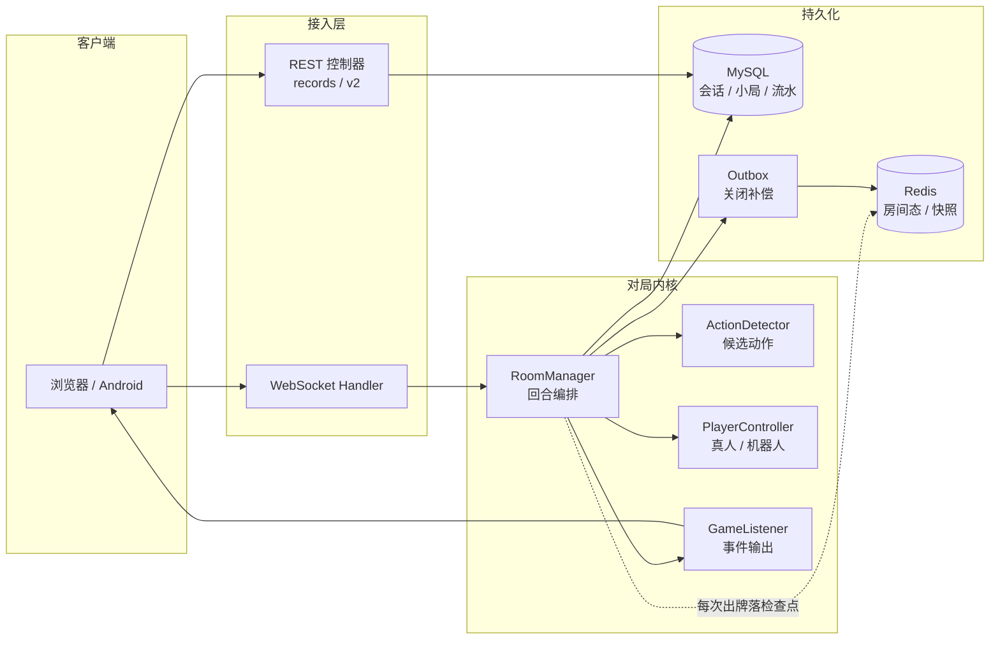

# 多人实时对战平台（海南麻将）

四人联网麻将服务端。多客户端异步操作下，服务端维护唯一、合法、可恢复的对局状态，并提供战绩查询与容量监控。

[在线试玩](http://jiangpahnmj.cn) · [Android APK](HainanMaJhong/src/main/resources/static/apk/jiangpahnmj.apk) · [架构](#架构) · [实测结果](#实测结果) · [文档索引](#文档索引)

Java 17 / Spring Boot 2.7 / MyBatis-Plus / MySQL / Redis / WebSocket · 前端 Vue 3 / Vite
单机部署（2 vCPU / 1.6 GiB），systemd 托管，生产额度 `RECORDS_RPS=800 / BURST=100`，18 条告警接入云端 Prometheus。

---

## 关键设计

| 关注点 | 做法 |
|---|---|
| 回合推进 | `RoomManager` 编排发牌、摸补花、出牌、响应与判胡；合法候选动作由 `ActionDetector` 纯计算，决策经 `PlayerController`，事件经 `GameListener` 输出 |
| 三方响应仲裁 | 先收齐各家选择（收集阶段不改手牌与牌河），再按实际动作优先级与座次统一仲裁、只执行一次；已无法胜出的候选提前结束询问 |
| 一次决策只被认领一次 | 引擎线程阻塞等待，玩家回复、超时任务与解散三方竞争同一个受锁完成标记，先到者生效，迟到应答丢弃 |
| 对局状态归属 | 状态由引擎线程独占；重同步只提交标记，快照在该线程边界生成，WebSocket 线程不遍历可变集合 |
| 私有数据下发 | 摸牌与暗杠按座位生成不同载荷，隐藏字段在服务端裁掉后才推送 |
| 结算与补偿 | 锁场次行、拒绝已关闭场次写入、按局号识别重复提交，小局与四家流水同事务提交；场次关闭走 Outbox，由轮询重放、幂等、退避与死信补偿 |
| 输入校验 | 客户端只回选项下标，动作由服务端从自存候选集取出执行 |

对局内核不依赖 WebSocket：同一套引擎可接真人或机器人，并有 3 机器人 + 1 真人、4 机器人两种对局回归测试，可脱离浏览器运行。

---

## 架构



---

## 实测结果

以下为最新一轮（2026-10-18），对应服务端包 `3cdf52f5…`。历史轮次与方法论见文档索引。

### 1. 容量边界：阶梯加压

80 桌 / 320 人 / 2 vCPU，每档 90 秒。

| 读速率 | CPU 均值 | 峰值 | >0.9 采样 | >0.95 采样 | 内存最低 |
|---|---|---|---|---|---|
| 80 GET/s | 0.436 | 0.603 | 0 | 0 | 460 MiB |
| 160 GET/s | 0.590 | 0.653 | 0 | 0 | 439 MiB |
| 240 GET/s | 0.772 | 1.000 | 1 | 1 | 442 MiB |
| 320 GET/s | 0.875 | 0.957 | 9 | 2 | 417 MiB |
| 400 GET/s | 0.953 | 0.984 | 14 | 11 | 388 MiB |

读路径舒适区 ≤ 240 GET/s（CPU 0.77），320 GET/s 逼近上限，400 GET/s 触发护栏，`stopReason = cpu-over-95-percent-for-60-seconds`。当前读路径容量边界约 320–400 GET/s。同期 429 共 293 个（0.29%），该轮瓶颈为 CPU，与准入额度无关。

> 各档房间数逐渐建满，该曲线为整段演进的上界，非每档重启后的单点值。纯净边界曲线需每档重启并 ramp 预热，尚未执行。

### 2. 稳定性：320 人双轮各 30 分钟

720,001 次请求，0 失败，读路径 P95 23 ms。

### 3. 读路径分页

| 指标 | 值 |
|---|---|
| `list-page2-v2`（`/api/v2/records?pageNum=2&pageSize=10`）客户端 P95 | 203 ms（200: 20,121 / 429: 74） |
| 同组服务端已接纳 P95 / P99 | 164 / 235 ms |
| 进入统计的路由 | records 40,243 · overview 20,124 · rounds 20,120 · pending 20,195 |

分页端点与同组首页服务端延迟接近，分页未额外放大延迟。

### 4. 准入额度对照

三档额度 240 / 160 / 128：拒绝率 0% / 13% / 27%，CPU 与已接纳延迟基本不变。该负载下额度影响削峰比例，不构成容量上限。

### 5. Outbox 故障注入

停 Redis 后事件落 `PENDING`（`attempts` 递增、`last_error=QueryTimeoutException`），Redis 恢复后自动补至 `DONE`，无需人工介入。当前 `pending=0 dead=0`。

---

## 构建与运行

依赖 JDK 17、Maven、Node.js ≥ 22、pnpm。复制 `HainanMaJHong/.env.example` 填写本地配置，初始化 MySQL 与 Redis。

```powershell
cd HainanMaJHong/frontend
pnpm install --frozen-lockfile --ignore-scripts
cd ..
./ops/build-release.ps1 -JavaHome '<JDK17目录>' -Maven '<mvn.cmd路径>'
```

产出 `target/HainanMaJHong2-1.0-SNAPSHOT.jar` 与 SHA256/源码清单。当前构建对应 92 项测试、0 失败、1 跳过；构建脚本编译但不运行测试。运行与验收见[项目说明](HainanMaJhong/README.md)。

部署校验以进程实际打开文件的 SHA-256 为准（`sha256sum /proc/$(systemctl show mahjong -p MainPID --value)/fd/N`），日志轮转由 logrotate 管理。

> 容量原始数据（测试账号、token、逐轮日志）不公开，仓库仅保留方法论、脚本与结论；`docs/performance/private/**` 已排除。

---

## 文档索引

| 内容 | 入口 |
|---|---|
| 代码阅读路径 | [代码阅读指南](docs/CODE-READING-GUIDE.md) → [RoomManager 精读](docs/ROOMMANAGER-READING-GUIDE.md) → [多人流程](docs/MULTIPLAYER-READING-GUIDE.md) |
| 压测到优化与反证的全过程 | [方法论与实测证据](HainanMaJhong/docs/八天并发优化方法论_2026-10-16.md) |
| 并发模式与各自失效条件 | [并发模式与失效清单](HainanMaJhong/docs/并发模式与失效清单.md) |
| 额度、护栏与回退 | [运行边界与线上额度](HainanMaJhong/docs/运行边界与线上额度_2026-10-16.md) |
| 关闭补偿设计与状态 | [房间收尾 Outbox](HainanMaJhong/docs/房间收尾Outbox_2026-10-17.md) |
| 复现压测与公开结果（152 轮逐轮汇总） | [压测入口](docs/performance/README.md) · [公开结果](HainanMaJhong/docs/压测记录汇总.md) · [JMeter 同画像](HainanMaJhong/ops/loadtest/jmeter/README.md) |
| 全部文档 | [文档总索引](HainanMaJhong/docs/README.md) |
