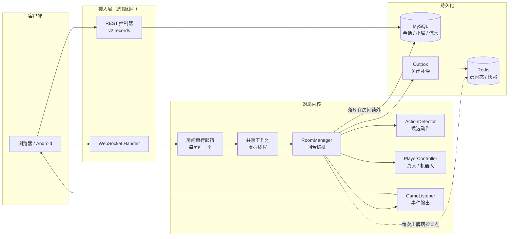

# 多人实时对战平台（海南麻将）

四人联网麻将服务端。多客户端异步操作下，服务端维护唯一、合法、可恢复的对局状态，并提供战绩查询与容量监控。

[在线试玩](http://jiangpahnmj.cn) · [Android APK](HainanMaJhong/src/main/resources/static/apk/jiangpahnmj.apk) · [架构](#架构) · [实测结果](#实测结果) · [文档索引](#文档索引)

**当前版本 `v2`**（tag `v2` / 分支 `release/v2-arch`）。Java 21 / Spring Boot 2.7 / MyBatis-Plus / MySQL / Redis / WebSocket · 前端 Vue 3 / Vite。
单机部署（2 vCPU / 1.6 GiB，50 Mbps），systemd 托管，生产额度 `RECORDS_RPS=800 / BURST=100`，19 条告警接入本机 Prometheus + 邮件通知。

---

## 关键设计

| 关注点 | 做法 |
|---|---|
| 回合推进 | `RoomManager` 编排发牌、摸补花、出牌、响应与判胡；合法候选动作由 `ActionDetector` 纯计算，决策经 `PlayerController`，事件经 `GameListener` 输出 |
| 三方响应仲裁 | 先收齐各家选择（收集阶段不改手牌与牌河），再按实际动作优先级与座次统一仲裁、只执行一次；已无法胜出的候选提前结束询问 |
| 一次决策只被认领一次 | 玩家回复、超时与取消竞争一次性完成标记，完成后投递房间事件，等待时不占用线程，迟到应答丢弃 |
| **执行模型** | 同一房间的事件投递到**串行邮箱**，由共享工作池（虚拟线程）执行；**不存在每房间线程**，128 桌与 240 桌的线程数恒定在 50 左右 |
| 对局状态归属 | 状态由房间串行邮箱独占；快照在事件边界生成，WebSocket 线程不遍历可变集合 |
| **结算落库** | 结算的数据库写入**在房间锁外**完成（先快照 → 解锁 → 落库 → 广播），避免锁持有期间做网络 I/O |
| 私有数据下发 | 摸牌与暗杠按座位生成不同载荷，隐藏字段在服务端裁掉后才推送 |
| 结算与补偿 | 锁场次行、拒绝已关闭场次写入、按局号识别重复提交，小局与四家流水同事务提交；场次关闭走 Outbox，由轮询重放、幂等、退避与死信补偿 |
| 输入校验 | 客户端只回选项下标，动作由服务端从自存候选集取出执行 |

### v2 相对 v1 的两处结构性改动

**① 每房间阻塞线程 → 串行事件队列 + 共享工作池**

v1 每个房间固定占用 2 个平台线程（引擎 + 计时器），128 桌需要约 256 个线程。v2 把同一房间的事件投递到串行邮箱，由共享池执行，线程数与房间数解耦。

**② JDK 17 → JDK 21 虚拟线程**

接入层（Tomcat）、牌局事件、后台 I/O 全部改用虚拟线程；所有阻塞路径从 `synchronized` 改为 `ReentrantLock`，避免 pinning。迁移方案与 pinning 审计见 [JDK21与虚拟线程迁移](HainanMaJhong/docs/JDK21与虚拟线程迁移_2026-10-25.md)。

**⇒ 净效果**：线程数 217 → 50，系统上下文切换 −42%，被抢占 −39%，sys% −4.8 点；**真实画像容量 512 人 → 960 人**。

对局内核不依赖 WebSocket：同一套引擎可接真人或机器人，并有 3 机器人 + 1 真人、4 机器人两种对局回归测试，可脱离浏览器运行。

---

## 架构



---

## 实测结果

以下为最新一轮（**2026-10-25**），对应服务端包 `25fe781a17979a38`（v2）。历史轮次见[压测记录汇总](HainanMaJhong/docs/压测记录汇总.md)。

### 1. 容量上限：优化前后对比（真实画像 0.2 GET·s⁻¹·桌⁻¹）

| 人数 | 优化前（v1 阻塞模型） | **优化后（v2 事件驱动 + 虚拟线程）** |
|---:|---|---|
| 512 | ✅ P95 **36.3 ms**，线程 **217–220** | ✅ P95 **35.8–41.9 ms**，线程 **50** |
| 800 | 未测 | ✅ P95 **43–45 ms**，线程 50 |
| 880 | 未测 | ✅ P95 **46–49 ms**，线程 50 |
| **960** | **不可达** | ✅ **P95 49.9–53.5 ms，P99 55.5–74.3 ms，线程 50** |
| 1,040 | 不可达 | ✗ P95 **63.7–70.0 ms**（超 60 ms 阈值）|

**容量提升 1.875×（512 → 960）**；同为 512 人时延迟几乎不变（36.3 → 35.8 ms），说明优化不是"提速"，而是**解除了线程数随房间数线性增长的天花板**。

延迟拐点在 **960–1,040 人之间**：1,040 人时 P95 全面越过 60 ms，CPU 进入饱和区。

### 2. 稳定性：800 人单轮 30 分钟

200 桌 / 800 人 / 1,800 秒，真实画像。

| 端点 | 请求数 | P95 | P99 | max |
|---|---:|---:|---:|---:|
| list-v2 | 14,401 | 50.8 ms | 69.9 ms | 422 ms |
| overview-v2 | 14,400 | 51.2 ms | 68.8 ms | 437 ms |
| rounds-v2 | 14,400 | 53.5 ms | 74.3 ms | 351 ms |
| list-page2-v2 | 14,400 | 51.2 ms | 68.6 ms | 319 ms |
| pending | 14,400 | 41.5 ms | 60.2 ms | 290 ms |

**72,001 请求 · 失败 0 · 限流 0 · 40.00 req/s 精确 · 结算 101–116 手/局**。与 5 分钟测试（43–45 ms）相比仅慢 7 ms，无明显资源累积。

> 计划两轮 30 分钟，第 2 轮因压测工具判据（`pendingDiscards.size === 0`）在长跑中不成立而中止，属工具缺陷，非服务端问题。

### 3. 调度开销：虚拟线程的实测收益（128 桌 / 512 人）

| 版本 | 线程 | 系统 cs | 被抢占 | us : sys | list P95 |
|---|---:|---:|---:|---|---:|
| JDK17 事件驱动（热） | 72 | 33,436/s | 6,339/s | 65.8 : 34.2 | 36.3 ms |
| **JDK21 + 虚拟线程（热）** | **50** | **19,510/s** | **3,854/s** | **70.6 : 29.4** | **35.8 ms** |

cs −42%、被抢占 −39%、sys% −4.8 点。对客户端延迟仅贡献约 4% —— 虚拟线程的收益在**调度开销**，不在"让业务变快"。

### 4. 容量结论

| 口径 | 数值 | 依据 |
|---|---:|---|
| **对外承诺** | **800 人** | 30 分钟长跑实测，P95 50 ms，余量 17% |
| 技术上限 | 960 人 | 阶梯实测通过，未做长跑 |
| 延迟拐点 | ~1,040 人 | P95 突破 60 ms |

瓶颈排序（960 人时）：**CPU（约 95%）> 带宽（约 24/50 Mbps）> 内存（约 850 MiB）> 线程（恒定 50，不构成约束）**。

---

## 构建与运行

依赖 JDK 21、Maven、Node.js ≥ 22、pnpm。复制 `HainanMaJHong/.env.example` 填写本地配置，初始化 MySQL 与 Redis。

```powershell
cd HainanMaJHong/frontend
pnpm install --frozen-lockfile --ignore-scripts
cd ..
./ops/build-release.ps1 -JavaHome '<JDK21目录>' -Maven '<mvn.cmd路径>'
```

产出 `target/HainanMaJHong2-1.0-SNAPSHOT.jar` 与 SHA256/源码清单。当前构建对应 **112 项测试、0 失败、1 跳过**；构建脚本编译但不运行测试。运行与验收见[项目说明](HainanMaJhong/README.md)。

**注意**：Java 21 构建的 jar **不能用 JDK 17 运行**。回滚时需同时替换 jar 与运行时，步骤见 [JDK21与虚拟线程迁移](HainanMaJhong/docs/JDK21与虚拟线程迁移_2026-10-25.md) 的"回滚"一节。

部署校验以进程实际打开文件的 SHA-256 为准（`sha256sum /proc/$(systemctl show mahjong -p MainPID --value)/fd/N`），日志轮转由 logrotate 管理。

> 容量原始数据（测试账号、token、逐轮日志）不公开，仓库仅保留方法论、脚本与结论；`docs/performance/private/**` 已排除。

---

## 文档索引

| 内容 | 入口 |
|---|---|
| **全部文档导航（推荐起点）** | [文档总索引](docs/README.md) |
| 代码阅读路径 | [代码阅读指南](docs/CODE-READING-GUIDE.md) → [RoomManager 精读](docs/ROOMMANAGER-READING-GUIDE.md) → [多人流程](docs/MULTIPLAYER-READING-GUIDE.md) → [HTTP 层规范](docs/HTTP-LAYER-ALIGNMENT.md) |
| **本次容量结论与优化验证** | [容量上限与优化验证 2026-10-25](HainanMaJhong/docs/容量上限与优化验证_2026-10-25.md) |
| JDK 21 与虚拟线程迁移 | [迁移方案与 pinning 审计](HainanMaJhong/docs/JDK21与虚拟线程迁移_2026-10-25.md) |
| 事件驱动状态机改造 | [改造设计与决策](HainanMaJHong/docs/事件驱动状态机改造_2026-10-24.md) |
| 压测到优化与反证的全过程 | [方法论与实测证据](HainanMaJHong/docs/八天并发优化方法论_2026-10-16.md) |
| 并发模式与各自失效条件 | [并发模式与失效清单](HainanMaJHong/docs/并发模式与失效清单.md) |
| 额度、护栏与回退 | [运行边界与线上额度](HainanMaJHong/docs/运行边界与线上额度_2026-10-16.md) |
| 关闭补偿设计与状态 | [房间收尾 Outbox](HainanMaJHong/docs/房间收尾Outbox_2026-10-17.md) |
| 复现压测与公开结果（150+ 轮逐轮汇总） | [压测入口](docs/performance/README.md) · [公开结果](HainanMaJHong/docs/压测记录汇总.md) · [JMeter 同画像](HainanMaJHong/ops/loadtest/jmeter/README.md) |
| 压测工具本身的局限 | [性能测试工具已知偏差](HainanMaJHong/docs/性能测试工具已知偏差.md) |
